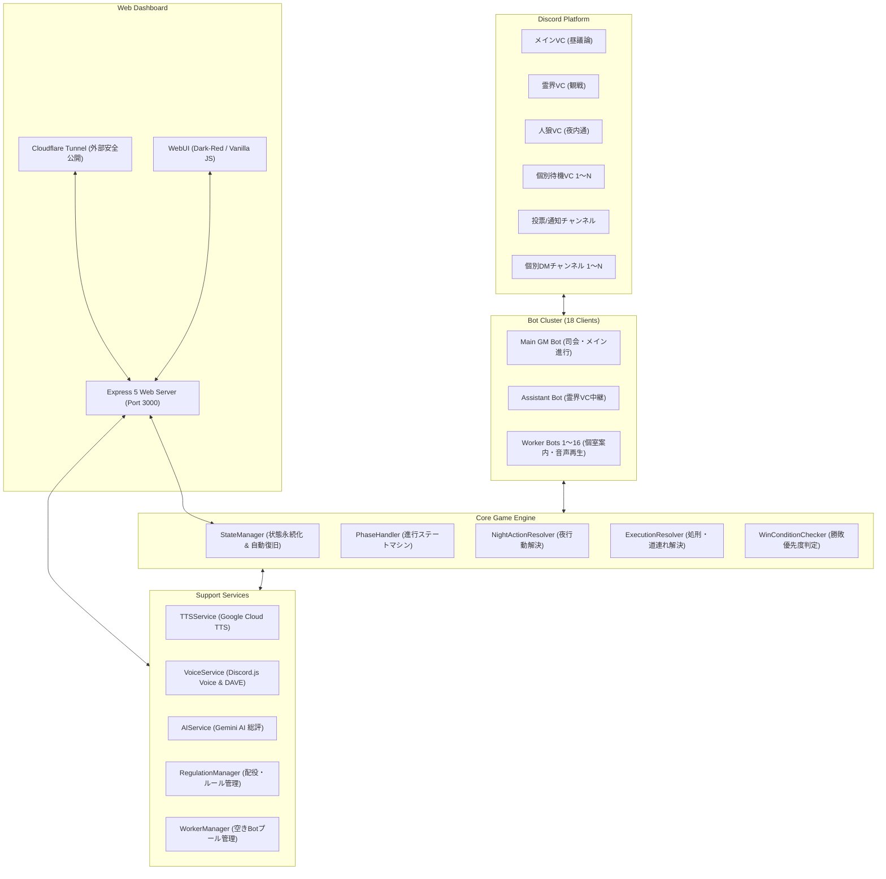
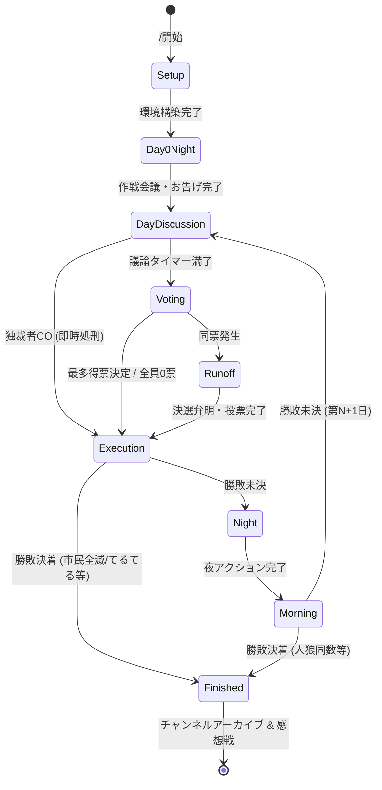
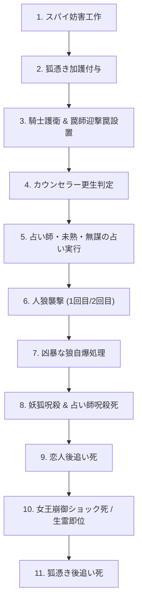

# 🐺 人狼 AI GM Bot - 完全詳細仕様書 (System Architecture & Specification Manual)

本書は、**人狼 AI GM Bot** の内部アーキテクチャ、ゲーム進行エンジン、役職解決ロジック、並行Worker管理、音声配信、Webダッシュボード、AI総評システム、および永続化・復旧機構に至るすべての設計・仕様を網羅した詳細技術仕様書です。

---

## 📑 目次

1. [システム全体アーキテクチャ](#1-システム全体アーキテクチャ)
2. [Bot構成とマルチクライアント設計](#2-bot構成とマルチクライアント設計)
3. [ゲーム状態管理と永続化・リカバリ機構](#3-ゲーム状態管理と永続化リカバリ機構)
4. [フェーズ遷移とゲーム進行シーケンス](#4-フェーズ遷移とゲーム進行シーケンス)
5. [ルール解決エンジン（Engine Specification）](#5-ルール解決エンジンengine-specification)
6. [WorkerBot（スタッフBot）並行管理システム](#6-workerbotスタッフbot並行管理システム)
7. [音声合成（TTS）＆ボイス配信パイプライン](#7-音声合成ttsボイス配信パイプライン)
8. [レギュレーション管理システム](#8-レギュレーション管理システム)
9. [AI総評・感想戦分析エンジン（AIService）](#9-ai総評感想戦分析エンジンaiservice)
10. [Webダッシュボード＆API仕様](#10-webダッシュボードapi仕様)
11. [Discordスラッシュコマンド仕様](#11-discordスラッシュコマンド仕様)

---

## 1. システム全体アーキテクチャ

本システムは、Discord VoiceおよびTextを活用した完全自動の人狼ゲームマスター環境を提供します。高音質な音声合成、複数個室VCへの並行Bot配置、Webによる配役ビルダー、Gemini AIによるゲーム講評をシームレスに統合しています。



### 技術スタック
- **言語・ランタイム**: TypeScript 7.0 / Node.js v26 & Bun v1.4.4
- **Discord API**: `discord.js` v14.26, `@discordjs/voice` v0.19, DAVE E2E暗号化対応
- **音声コーデック**: `@discordjs/opus`, `prism-media`, `sodium-native`
- **音声合成**: Google Cloud Text-to-Speech API (`@google-cloud/text-to-speech`)
- **生成AI**: Google Gemini API (`@google/genai`)
- **Webフレームワーク**: Express 5.3, `express-session`, `cookie-parser`, WebSocket (`ws`)
- **トンネリング**: Cloudflare Tunnel (`cloudflared`)

---

## 2. Bot構成とマルチクライアント設計

本システムは、**合計18体**のDiscord Clientインスタンスを同時に協調動作させるマルチBotクラスタアーキテクチャを採用しています。

| Bot種別 | 台数 | 役割・責務 |
| :--- | :--- | :--- |
| **Main GM Bot** | 1体 | スラッシュコマンド受付、環境構築（カテゴリ・VC・テキスト生成）、メインVCでの司会進行、勝敗宣言、プレイヤー移動・ミュート制御 |
| **Assistant Bot** | 1体 | 霊界VC（死亡者用）に常駐し、メインVCの音声を霊界へリアルタイム同時中継（ブロードキャスト） |
| **Worker Bots (バイトBot)** | 16体 | ① 霊界VCでの幽霊リスナー待機<br>② 夜フェーズ時に各役職（霊媒・人狼・占い・騎士・特殊役職等）の個別VCへ接続し、個別の音声案内・結果復唱を実行<br>③ 昼議論中の相槌発話 |

### WorkerBotのライフサイクル
1. システム起動時に `WorkerManager.getInstance().loginWorkers()` が実行され、16体のトークンで順次Discord Gatewayへログイン。
2. ニックネームが `[スタッフ01]` 〜 `[スタッフ16]` に初期化。
3. プレイヤーとしてゲームに参加しているWorkerBotを自動検知し、スタッフ業務プールから除外（プレイヤーのなりすまし・誤作動防止）。
4. 霊界VCおよび夜の個室VCへ必要最小限のBotを動的に割り当て、使用完了後は速やかに切断・待機状態へ復帰。

---

## 3. ゲーム状態管理と永続化・リカバリ機構

### データモデル (`GameState`)
ゲームの全進行状態は単一の `GameState` オブジェクトとして管理されます。

```typescript
export interface GameState {
  gameId: string;
  serverId: string;
  categoryId: string;
  mainVcId: string;
  wolfVcId: string;
  ghostVcId: string;
  voteChannelId: string;
  wolfTextChannelId: string;
  phase: GamePhase;
  day: number;
  players: Player[];
  executedUserId?: string;
  lastGuardedUserId?: string;
  loversUserIds?: string[];
  femmeFataleData?: { femmeFataleId: string; honeyId: string; pawnIds: string[] };
  livingSpiritData?: Record<string, string>;
  queenUserId?: string;
  toughGuyPoisoned?: Record<string, boolean>;
  wolfCubRevenge?: boolean;
  dictatorUsed?: boolean;
  apprenticeDivinerAwakened?: boolean;
  nightActions: NightActions;
  speechLogs: SpeechLog[];
  eventLogs: string[];
  isPaused: boolean;
  startedAt: number;
  endedAt?: number;
}
```

### 永続化メカニズム
- ゲーム状態が変更されるたび、`data/games/<gameId>.json` にアトミック書き込み（`.tmp` ファイル作成後に一瞬で `fs.rename` 置換）を行い、急なOSクラッシュやコンテナ停止でもJSONファイルの破損を物理的に防ぎます。

### 自動復旧（リカバリ機構）
1. コンテナ起動時、`StateManager.findLatestActiveGame()` が `data/games/` 配下を走査し、最新かつ未終了（`phase !== 'finished'`）のゲームファイルを自動検出。
2. 未終了ゲームが存在する場合、`PhaseHandler.resumeGame()` が自動起動。
3. カテゴリやチャンネルの接続を再確立し、生存プレイヤーのVC配置およびマイクミュート状態を直前のフェーズに合わせて自動同期。
4. 中断されていたタイマーや夜アクション受付を1分間のボーナス延長付きで安全に再開。

---

## 4. フェーズ遷移とゲーム進行シーケンス



### 各フェーズの詳細動作

#### 1. Setup（環境構築・開村）
- カテゴリ「🐺 人狼ゲーム (進行中)」を作成。
- メインVC、人狼VC、霊界VC、メイン進行テキストチャンネル、および参加者全員分の「個室待機VC」と「個別テキストチャンネル」を動的に生成。
- 参加権限（権限オーバーライド）を各プレイヤーごとに設定し、他のプレイヤーの個室を覗けないように隔離。
- GMがロビーVCへ接続し、レギュレーション読み上げ（設定ON時）を実施後、全プレイヤーを各自の個室待機VCへ強制移動して全員をミュート。

#### 2. Day0Night（役職配布 ＆ 初日夜）
- 各プレイヤーの個別チャンネルへ役職情報と役職詳細カードを送信。
- キューピット、悪女、生霊が存在する場合、各個室VCへスタッフBotが接続してプロンプト音声を再生し、初日選択UI（恋人指定、本命指定、憑依指定）を提示。
- 人狼陣営を人狼VCへ移動させ、作戦会議（ミュート解除）を実施。
- 初日白通知ルール有効時、占い師の個室VCへスタッフBotが接続し、「{プレイヤー名}さんは、村人陣営です」と音声でお告げを伝達。

#### 3. DayDiscussion（昼の議論）
- 生存者全員をメインVCへ集合させ、全員のマイクミュートを解除。
- GMが「第N日目の議論時間はM分間です。それでは、議論を開始してください」と発声し、タイマーを開始。
- **独裁者CO割り込み**: 議論中、独裁者が「独裁者CO」ボタンを押すと、即座に議論タイマーが強制停止され、全員がマイクミュート。独裁者が処刑者を指名し、通常の投票をスキップして即座に処刑フェーズへ直行。

#### 4. Voting（投票フェーズ）
- 生存者全員をミュートした状態で、挙手またはランダム順に1人ずつ発言時間を付与（発言者のみ一時ミュート解除）。
- 発言終了後、個別ボタンUIにより投票先を選択。
- 単独最多得票者が決まれば処刑フェーズへ遷移。同票の場合は決選投票へ。

#### 5. Runoff（決選投票フェーズ）
- 最多得票の対象者たちに1分ずつの弁明時間を付与。
- 対象者以外のプレイヤーによる再投票を実施。再度同票となった場合は、レギュレーション設定（`runoffTieBreaker`）に従い、「ランダム処刑」または「処刑なし」に決定。

#### 6. Execution（処刑・遺言フェーズ）
- 処刑対象者のミュートを解除し、遺言時間を付与。
- 処刑完了後、死亡者を霊界VCへ移動。
- **道連れ・能力解決**:
  - ハンター処刑: 遺言中に道連れ対象を指名し、銃撃音とともに即座に道連れ死。
  - 黒猫処刑: 生存者から「人狼以外」をランダムに1名道連れ死。
  - 猫又処刑: 生存者から完全ランダムに1名道連れ死。
  - 人狼の子ども処刑: 親狼が激怒し、今夜の襲撃回数が2回に増加。
  - 女王処刑: 生霊が憑依していない場合、全市民がショック死し村人即座敗北。生霊が憑依していた場合、生霊が新女王に即位。
  - 恋人死亡: 残された恋人が後を追って即座に自殺。

#### 7. Night（夜フェーズ）
- 全員が個別待機VCへ移動。
- 各役職の個室VCへスタッフBot（WorkerBot）が接続し、プロンプト音声を発声。
- 各自の個別チャンネルに設置されたセレクトメニューから夜アクションを実行。選択完了時に個室VCで復唱・結果音声を再生。
- 全員の行動完了、および離席者（トイレ等）の帰還を確認後、ルール解決エンジンを実行。

#### 8. Morning（朝の発表）
- 生存者および昨晩の犠牲者をメインVCへ集合。
- 昨晩の犠牲者をGMが音声で発表（複数人死亡、タフガイ毒死、パン屋のパン焼き成否を含む）。
- 発表完了後、犠牲者を霊界VCへ移動させミュート解除。

#### 9. Finished（ゲーム終了・感想戦）
- 勝敗宣言音声をメインVCおよび霊界VCに同時ブロードキャスト。
- 全員の役職一覧と生死をチャットに開示。
- Gemini AIによるMVP総評をテキストおよび音声で発表。
- 一定時間経過後、チャンネルをアーカイブ・片付けして終了。

---

## 5. ルール解決エンジン（Engine Specification）

### 1. 夜行動解決パイプライン (`NightActionResolver`)
夜フェーズにおける各能力の干渉・バッティングは、以下の**厳格な優先順位シーケンス**に従って順番に解決されます。



#### バッティング解決規則
1. **スパイ妨害**:
   - スパイが指定したプレイヤーの夜能力（占い、護衛、罠、加護等）は完全に不発となります。
2. **騎士護衛 vs 罠師迎撃**:
   - **騎士**: 人狼の襲撃から対象を守ります。
   - **罠師**: 襲撃してきた人狼を返り討ちにして人狼を死亡させます（襲撃された市民は生存）。
   - **双方が同じ対象を守った場合**: 罠師が優先され、人狼が迎撃死します。
3. **狙われる市民**:
   - 人狼に襲撃された際、死亡せずに「人狼」に感染・変化します（護衛されていた場合は襲撃自体が無効化され感染しません）。
4. **タフガイ**:
   - 人狼に襲撃された際、その夜は死亡せず生存します。翌日昼の議論に参加できますが、翌夜の開始時に毒が回り死亡します。
5. **凶暴な狼**:
   - 2回襲撃を実行した場合、翌朝に反動で自爆死します。

### 2. 処刑時解決パイプライン (`ExecutionResolver`)
昼の処刑時に発生する能力誘発（道連れ、後追い、激怒）を解決します。

- 処刑対象が死亡ステータスへ移行。
- 棺桶屋の予想と突合（的中ならヒットカウント加算、2回的中で即座勝利判定）。
- 人狼の子どもの場合、`wolfCubRevenge = true` をセット。
- 猫又処刑時、生存者からランダム1名選出して死亡。
- 黒猫処刑時、生存者の中から「人狼陣営以外」をランダム1名選出して死亡。
- ハンター処刑時、本人が指定した対象を死亡。
- 恋人が死亡した場合、相方の恋人が後追い死。
- 女王が死亡した場合、生霊憑依がなければ全市民がショック死。生霊がいれば生霊が女王に即位。

### 3. 勝敗優先度判定 (`WinConditionChecker`)
複数の陣営が同時に勝利条件を満たした場合の曖昧さを排除するため、以下の**厳格な優先順位**で判定します。

| 優先度 | 陣営 / 役職 | 勝利条件 |
| :---: | :--- | :--- |
| **1位** | **てるてる坊主** (`fool`) | 昼の投票で自身が処刑された瞬間に単独勝利 |
| **1位** | **棺桶屋** (`undertaker`) | 翌日処刑者の予想を2回的中させた瞬間に単独勝利 |
| **2位** | **恋人陣営** (`lovers`) | すべての敵対陣営（他の人間・人狼）が排除され、恋人ペアを含む少数が生存 |
| **3位** | **一匹狼** (`lone_wolf`) | 通常の人狼が全滅し、一匹狼が最後の1匹として生存した状態で村人と同数以下にする |
| **4位** | **神様** (`god`) | 人狼全滅または村人全滅の決着時まで一度も死亡せずに生存している |
| **5位** | **妖狐陣営** (`fox`) | 村人陣営または人狼陣営の勝利条件が満たされた際、妖狐が1名でも生存している |
| **6位** | **村人陣営** (`villager`) | すべての人狼（および一匹狼）が全滅している |
| **6位** | **人狼陣営** (`werewolf`) | 生存している人狼の数が、生存している人間の数以上になっている |

---

## 6. WorkerBot（スタッフBot）並行管理システム

16体のWorkerBotは `WorkerManager` クラスによって排他的に管理されます。

```typescript
export class WorkerManager {
  private workers: Client[] = [];
  private busyWorkers: Set<string> = new Set();

  // 空きBotの動的取得（プレイヤー参加中のBotは除外）
  public async getFreeWorkers(serverId: string, playerUserIds: string[], count: number): Promise<Client[]>;
  
  // 霊界VCのリスナーBot数調整
  public async adjustGhostWorkers(gameId: string, ghostVc: VoiceBasedChannel, targetCount: number, playerUserIds: string[]): Promise<void>;
}
```

### 排他制御とキュー管理
- 各WorkerBotには個別のミューテックス（`workerLocks`）が割り当てられており、音声再生タスク（`playVoiceTask`）が直列化されます。これにより、1体のBotが複数のVCへ同時に接続を試みる衝突（Race Condition）を完全に防止します。

---

## 7. 音声合成（TTS）＆ボイス配信パイプライン

### 音声合成 (`TTSService`)
- **プロバイダ**: Google Cloud Text-to-Speech API
- **音声モデル**: 日本語（`ja-JP-Neural2-B` / 男性、`ja-JP-Neural2-C` / 女性 など設定可能）
- **最適化キャッシュ**:
  - 静的なアナウンス（夜の訪れ、昼の終了、投票案内など30種以上）はシステム起動時にプリフェッチ生成しメモリ・ディスクにキャッシュ。
  - 動的アナウンス（プレイヤー名を含む結果発表等）は `data/audio/<hash>.mp3` に永続化し、同一文面でのAPI課金と遅延をゼロ化。

### ボイス配信 (`VoiceService`)
- Discord VoiceConnectionのプール管理と状態監視。
- **ブロードキャスト配信**: メインVCと霊界VCへ同一のAudioResourceを完全同期して並行ストリーミング。

---

## 8. レギュレーション管理システム

### 構成要素
1. **役職配分マップ (`roles`)**: `{ werewolf: 2, seer: 1, knight: 1, villager: 5, ... }`
2. **ルールオプション (`rules`)**:
   - `firstNightDivination`: `'white_npc'`（お告げあり） / `'free'`（自由占い） / `'none'`（初日なし）
   - `consecutiveGuard`: `boolean`（騎士の同一対象連続護衛可否）
   - `runoffTieBreaker`: `'random_execution'`（ランダム処刑） / `'no_execution'`（処刑なし）
   - `hasMediumResult`: `boolean`（霊媒結果発表有無）
   - `wolfVoiceChat`: `boolean`（夜の人狼VC会話の許可）
3. **タイマー設定 (`times`)**: 昼議論時間、夜行動時間、遺言時間など
4. **演出設定 (`system`)**: GM音声、AI解析モデル、講評トーン、レギュレーション読み上げON/OFF

### プリセット一覧
- `preset_standard_11`: 標準11人村
- `preset_standard_13`: 標準13人村
- `preset_special_8`: 8人特殊村（未熟な占い師、狐憑き、棺桶屋など）
- `preset_lovers_12`: 12人恋人・キューピット村
- `preset_chaos_16`: 16人混沌村（女王、悪女、ハンター、独裁者、スパイなど）

---

## 9. AI総評・感想戦分析エンジン（AIService）

ゲーム終了後、Gemini AIがゲーム全体のログを精査し、プロの観点から感想戦を自動執筆します。

### 入力データ
1. **村のレギュレーション情報**:
   `RegulationManager.formatSummary` により、採用されたルール設定と「実際の配役内訳（例: 村人 3名、人狼 2名、ハンター 1名...）」を動的に文章化してプロンプトへ注入。
2. **発言ログ (`speechLogs`)**: 各フェーズでの全プレイヤーの発言書き起こし。
3. **イベントログ (`eventLogs`)**: 処刑、襲撃、護衛、道連れなどの全システム記録。

### 評価モード
- `discussion`: 議論を主導し論理的に村を引っ張った「議論MVP」を選出。
- `contribution`: 役職の能力遂行や決定打で勝利に導いた「勝利貢献MVP」を選出。
- `compare`: 議論MVPと勝利貢献MVPの2名をダブル表彰。

### インテリジェント・フォールバック
- 指定モデル（Pro等）でレート制限（TPM/RPM）や権限エラーを検知した場合、システムが自動的に安全な無料枠モデルチェーン（`gemini-flash-latest` ➔ `gemini-3-flash` ➔ `gemini-3.1-flash-lite` ➔ `gemini-2.5-flash`）へ強制ダウングレードして即時再試行。
- リクエストキューによる直列化処理でTPM超過を恒久的に防ぎます。

---

## 10. Webダッシュボード＆API仕様

Express 5ベースのWebサーバー（デフォルトポート: 3000）が稼働しています。

### 主要APIエンドポイント

| メソッド | パス | 説明 | 認証 |
| :--- | :--- | :--- | :---: |
| `GET` | `/api/auth/login` | Discord OAuth2 ログイン開始 | 不要 |
| `GET` | `/api/auth/callback` | OAuth2 コールバック処理 | 不要 |
| `GET` | `/api/auth/me` | ログイン中ユーザー情報の取得 | 要 |
| `GET` | `/api/roles` | 利用可能な全役職定義一覧の取得 | 要 |
| `GET` | `/api/regulations` | 登録レギュレーション一覧の取得 | 要 |
| `POST` | `/api/regulations` | カスタムレギュレーションの保存 | 要 |
| `DELETE` | `/api/regulations/:id` | カスタムレギュレーションの削除 | 要 |
| `GET` | `/api/system-settings` | 全体システム設定の取得 | 要 |
| `POST` | `/api/system-settings` | 全体システム設定の更新 | 管理者のみ |
| `GET` | `/api/tunnel` | Cloudflare Tunnel のステータス・公開URL取得 | 管理者のみ |
| `GET` | `/api/ai-models` | 利用可能なGeminiモデル動的一覧取得 | 要 |
| `GET` | `/ws/logs` | リアルタイムシステムログストリーミング (WebSocket) | 管理者のみ |

---

## 11. Discordスラッシュコマンド仕様

### 1. `/開始`
- **概要**: 人狼ゲームを開始します。
- **オプション**:
  - `レギュレーション` (String, 任意): 使用するレギュレーションID
  - `レギュレーション読み上げ` (Boolean, 任意): 開始時のGM読み上げON/OFF
- **前提条件**: 実行者がボイスチャンネルに接続していること（4名以上推奨）。

### 2. `/廃村`
- **概要**: 進行中のゲームを強制終了し、動的に作成されたチャンネルおよびロールを全削除して復帰します。
- **権限**: ギルド管理者、またはゲーム参加者。

### 3. `/一時停止` & `/再開`
- **概要**: 昼の議論タイマーや夜の制限時間を一時停止・再開します。トイレ休憩やトラブル対応に使用します。

### 4. `/ダッシュボード`
- **概要**: Web管理画面のURLを案内します（Cloudflare Tunnel有効時は公開URL、無効時はローカルURL）。

### 5. `/レギュレーション`
- **概要**: 現在登録されているレギュレーション一覧と役職構成をチャットにEmbed表示します。

### 6. `/再解析`
- **概要**: 直前のゲームログをもとに、現在のシステム設定（モデル・トーン・評価モード）でAI総評を再実行します。
