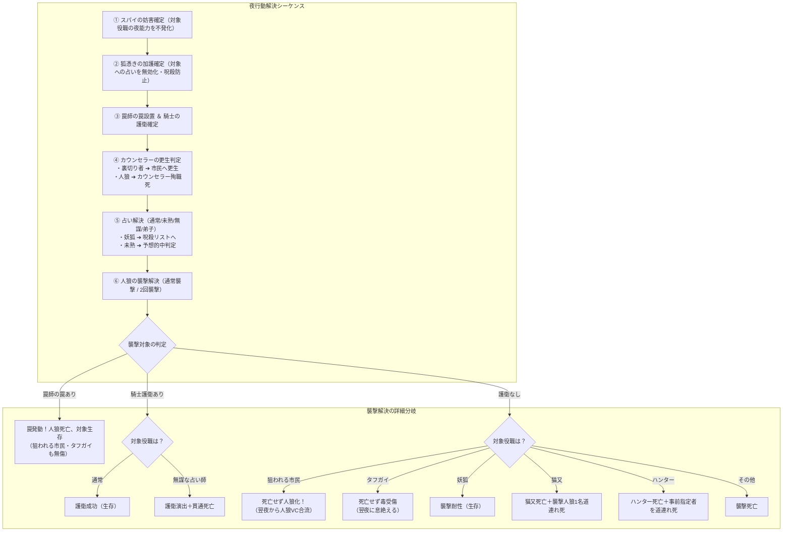

# 📜 人狼 AI GM Bot 役職一覧・能力・勝利条件仕様書 (scratch/role.md)

本書は、人狼 AI GM Bot における全役職の定義、能力、所属陣営、人数カウント種別、夜のアクション、および**勝利条件**と**能力バッティング解決ルール**をまとめた総合仕様書です。

---

## 📑 目次
1. [各陣営・役職の勝利条件一覧](#1-各陣営役職の勝利条件一覧)
2. [新規追加検討役職（全20種＋共有者）詳細仕様](#2-新規追加検討役職詳細仕様)
3. [特殊役職（4種）詳細仕様](#3-特殊役職4種詳細仕様)
4. [拡張役職（6種）詳細仕様](#4-拡張役職6種詳細仕様)
5. [標準役職（6種）詳細仕様](#5-標準役職6種詳細仕様)
6. [全役職クイックサマリー一覧表](#6-全役職クイックサマリー一覧表)
7. [役職能力のバッティング・矛盾解決ルール](#7-役職能力のバッティング矛盾解決ルール)

---

## 1. 各陣営・役職の勝利条件一覧

ゲーム終了時、以下の優先順位に従って勝利陣営・役職が確定します。

| 優先度 | 陣営 / 役職 | 勝利条件 | 備考 |
| :---: | :--- | :--- | :--- |
| **1 (最優先)** | **てるてる坊主** | **昼の投票（または独裁者）によって自分が処刑された瞬間** | その場でゲーム即時終了・単独勝利 |
| **1 (最優先)** | **棺桶屋** | **夜の処刑予想が累計2回的中した瞬間** | その場でゲーム即時終了・単独勝利 |
| **2** | **恋人陣営** (恋人、キューピット、悪女+本命) | **ゲーム終了時（村人勝利または人狼勝利の条件成立時）に恋人2名が生存** | 村人・人狼の勝利を上書きして恋人の勝利 |
| **3** | **一匹狼** | **全人狼が追放・死亡し、かつゲーム終了時に一匹狼が生存** | 通常の人狼陣営勝利を裏切り単独勝利 |
| **4** | **神様** | **ゲーム終了時（村人勝利または人狼勝利の条件成立時）に生存** | 生き残り単独勝利 |
| **5** | **妖狐陣営** (妖狐、狐憑き、背徳者) | **村人陣営または人狼陣営の勝利条件が満たされた際に妖狐が生存** | 村人・人狼の勝利を上書きして妖狐の勝利 |
| **6** | **村人陣営** | **すべての人狼（一匹狼を含む）が全滅** | 妖狐・恋人・単独第三陣営が全滅していること |
| **7** | **人狼陣営** | **生存している人狼の数が、生存している人間の数以上** | 妖狐・恋人・単独第三陣営が全滅していること |

> ※ **女王が死亡した場合**: 生霊による女王継承が発生しない限り、市民陣営全員がショック死し、**村人陣営は即座に完全敗北**となります。

---

## 2. 新規追加検討役職詳細仕様

### 1. ハンター (Hunter)
- **陣営**: 村人陣営 (`villager`) / **カウント**: 人間 (`human`)
- **夜行動**: なし（※夜襲撃時の事前道連れ指定UIあり） / **護衛**: ◯
- **勝利条件**: 村人陣営の勝利（人狼全滅）
- **能力詳細**:
  - 昼の投票で処刑された場合、または夜に人狼に襲撃されて死亡した場合、**生存者の中から誰か1人を指名して道連れ（銃殺）**にします。
  - **処刑時**: 処刑確定後、遺言タイム中に道連れ対象を選択。
  - **襲撃時**: 夜フェーズ中に「万一自分が死んだ場合の道連れ先」を事前指定（未指定時はランダム道連れ）。朝の犠牲者発表時に道連れ死が同時に発生。
  - ※ 女王ショック死による死亡時は道連れは発動しません。

### 2. 独裁者 (Dictator)
- **陣営**: 村人陣営 (`villager`) / **カウント**: 人間 (`human`)
- **夜行動**: なし / **護衛**: ◯
- **勝利条件**: 村人陣営の勝利（人狼全滅）
- **能力詳細**:
  - ゲーム中1度だけ、昼の議論中に「独裁者CO」ボタンを押すことで、**議論タイマーを強制終了させ、独断でその日の処刑者を1名決定**できます。
  - 発動した瞬間に全員がマイクミュートされ、GMアナウンス「独裁者が名乗り出ました。独裁者による即時処刑が行われます」が流れます。
  - 独裁処刑が行われた後、通常の投票はスキップされ、処刑者の遺言を経て夜フェーズへ移行します。

### 3. タフガイ (Tough Guy)
- **陣営**: 村人陣営 (`villager`) / **カウント**: 人間 (`human`)
- **夜行動**: なし / **護衛**: ◯
- **勝利条件**: 村人陣営の勝利（人狼全滅）
- **能力詳細**:
  - 人狼に襲撃されても、その夜は死亡せず耐え抜き、**翌朝の犠牲者発表では死亡しません**（本人には「襲撃されました。今夜息絶えます」と密かに通知）。
  - 翌日の昼議論・投票に通常通り参加した後、**その日の夜フェーズが訪れた瞬間（個別部屋へ移動した直後）に息絶えます**。
  - 翌々日の朝の発表で「無惨な死体」として公表されます。

### 4. 罠師 (Trapper)
- **陣営**: 村人陣営 (`villager`) / **カウント**: 人間 (`human`)
- **夜行動**: あり（毎晩1名に罠を設置、自分自身は不可） / **護衛**: ◯
- **勝利条件**: 村人陣営の勝利（人狼全滅）
- **能力詳細**:
  - 毎晩、自分以外の生存者1名を選んで罠を仕掛けます。
  - **守護効果**: 罠を仕掛けた対象は人狼の襲撃から護衛されます。
  - **迎撃効果**: 人狼が罠の仕掛けられた対象を襲撃した場合、**襲撃を実行した人狼が罠にかかって死亡**します（対象者は生存）。
  - 連続罠設置（同一人物への連続設置）はレギュレーション設定の「連続護衛ルール」に準拠。

### 5. カウンセラー (Counselor)
- **陣営**: 村人陣営 (`villager`) / **カウント**: 人間 (`human`)
- **夜行動**: あり（毎晩1名をカウンセリング指名） / **護衛**: ◯
- **勝利条件**: 村人陣営の勝利（人狼全滅）
- **能力詳細**:
  - 毎晩1名を指名してカウンセリングを行います。
  - **更生**: 指名した相手が「裏切り者（狂人・狂信者・スパイ・黒猫・狼の眷属）」だった場合、そのプレイヤーを**市民（村人）に更生**させます。対象者は役職が村人に変化し、勝利条件も村人陣営に書き換わります。
  - **殉職（自爆）**: 指名した相手が「人狼」だった場合、カウンセラー自身がショックで息絶え、翌朝無惨な死体となって発見されます。
  - 市民や第三陣営（妖狐・棺桶屋等）を指名した場合は何も起きません。

### 6. 一匹狼 (Lone Wolf)
- **陣営**: 第三陣営 (`third`) / **カウント**: 人狼 (`wolf`)
- **夜行動**: あり（人狼としての襲撃に参加） / **護衛**: ◯
- **勝利条件**: **通常の人狼が全員追放・死亡し、かつゲーム終了時に一匹狼が生存していること**
- **能力詳細**:
  - 占い・霊媒の判定は「人狼（黒）」、勝敗カウントも「人狼」。
  - 人狼の内通VCには参加せず、人狼同士はお互いを知っていますが、人狼側からも誰が一匹狼か分かりません（孤高の存在）。
  - 人狼陣営の勝利条件が満たされた際、一匹狼以外の通常人狼が全滅していれば、人狼勝利を上書きして「一匹狼の単独勝利」となります。

### 7. 恋人 (Lovers)
- **陣営**: 第三陣営 (`lovers`) / **カウント**: 人間 (`human`)
- **夜行動**: なし / **護衛**: ◯
- **勝利条件**: **ゲーム終了時（村人または人狼の勝利条件成立時）に恋人2名が生存していること**
- **能力詳細**:
  - 初めから互いが恋人であることを知っている2人組。
  - 占い・霊媒結果は「村人（白）」、カウントは人間。
  - **運命共同体（後追い死）**: どちらか片方が処刑・襲撃・呪殺・道連れ等で死亡した場合、**もう片方も即座に後を追って死亡**します。

### 8. 神様 (God)
- **陣営**: 第三陣営 (`third`) / **カウント**: 人間 (`human`)
- **夜行動**: なし / **護衛**: ◯
- **勝利条件**: **ゲーム終了時（村人または人狼の勝利条件成立時）に生存していること**
- **能力詳細**:
  - ゲーム開始時、村にいる全プレイヤーの「真の役職一覧」が個人テキストチャンネルに通知されます（全知全能）。
  - 占い・霊媒結果は白、カウントは人間。
  - 最後まで生き残れば神様の単独勝利となります。

### 9. スパイ (Spy)
- **陣営**: 人狼陣営 (`werewolf`) / **カウント**: 人間 (`human`)
- **夜行動**: あり（人間陣営の能力妨害） / **護衛**: ◯
- **勝利条件**: 人狼陣営の勝利
- **能力詳細**:
  - 毎晩、人間陣営のプレイヤー1名を指名し、その夜の能力（占い、護衛、霊媒、罠など）を不発（ロールブロック）にします。
  - **制限**: 妨害は「1つの役職につきゲーム中1回まで」（例: 占い師妨害は1回のみ）。
  - 妨害されたプレイヤーには「何者かの妨害により能力が使えなかった」と通知されます。

### 10. 内通者 (Informant)
- **陣営**: 人狼陣営 (`werewolf`) / **カウント**: 人間 (`human`)
- **夜行動**: なし / **護衛**: ◯
- **勝利条件**: 人狼陣営の勝利
- **能力詳細**:
  - 人狼が誰かを知っている狂人（※既存の「狂信者 (`fanatic`)」と同一仕様のエイリアス）。

### 11. 人狼の子ども (Wolf Cub)
- **陣営**: 人狼陣営 (`werewolf`) / **カウント**: 人狼 (`wolf`)
- **夜行動**: あり（人狼襲撃に参加） / **護衛**: ◯
- **勝利条件**: 人狼陣営の勝利
- **能力詳細**:
  - 昼の投票によって「人狼の子ども」が処刑された場合、親狼たちが激怒し、**その日の夜の人狼の襲撃が2回**になります。
  - ※ 襲撃死や道連れ死では発動しません。

### 12. 占い師の弟子 (Apprentice Diviner)
- **陣営**: 村人陣営 (`villager`) / **カウント**: 人間 (`human`)
- **夜行動**: なし（覚醒前） ➔ あり（覚醒後） / **護衛**: ◯
- **勝利条件**: 村人陣営の勝利（人狼全滅）
- **能力詳細**:
  - 村にいる本物の「占い師」が死亡した瞬間に覚醒し、翌夜から「占い師」として毎晩1名を占えるようになります。
  - 占い師が生存している間は能力のない通常の村人です。

### 13. 狙われる市民 (Targeted Civilian)
- **陣営**: 村人陣営 (`villager`) ➔ 人狼陣営 (`werewolf`) / **カウント**: 人間 ➔ 人狼
- **夜行動**: なし（人狼化前） ➔ あり（人狼化後） / **護衛**: ◯
- **勝利条件**: 人狼化前は村人勝利、人狼化後は人狼勝利
- **能力詳細**:
  - 人間陣営としてスタートしますが、**人狼に襲撃されると死亡せず、人狼に感染して「人狼」になります**。
  - 人狼化すると翌夜から人狼VCに合流し、襲撃に参加します。
  - 騎士や罠師に守られていた場合は襲撃自体が防がれるため、人狼化しません。

### 14. 黒猫 (Black Cat)
- **陣営**: 人狼陣営 (`werewolf`) / **カウント**: 人間 (`human`)
- **夜行動**: なし / **護衛**: ◯
- **勝利条件**: 人狼陣営の勝利
- **能力詳細**:
  - 昼の投票によって処刑された場合、**生存者の中から「人狼以外」の誰か1人をランダムに選んで道連れ**にします。
  - 人狼を巻き込むことなく確実に人間・第三陣営を道連れにする強力な人狼側の狂人枠。
  - 夜の襲撃や呪殺では道連れは発生しません。

### 15. キューピット (Cupid)
- **陣営**: 第三陣営 (`third`) / **カウント**: 人間 (`human`)
- **夜行動**: あり（初日夜に恋人2名を矢で射る） / **護衛**: ◯
- **勝利条件**: **自分が作った恋人2名が最後まで生存していること**
- **能力詳細**:
  - 初日夜に生存者の中から2名を選んで「恋人」にします（自分自身を含めることも可能）。
  - 選ばれた2名は元の役職を保持したまま「恋人」ステータスが付与され、第三陣営（恋人陣営）になります。
  - キューピット自身が恋人でない場合、自身の生死は勝利条件に影響しませんが、**恋人2名が両方死亡した場合はキューピットも後を追って死亡**します。

### 16. 悪女 (Femme Fatale)
- **陣営**: 第三陣営 (`third`) / **カウント**: 人間 (`human`)
- **夜行動**: あり（初日夜に本命1名と手玉複数名を選択） / **護衛**: ◯
- **勝利条件**: **悪女本人と本命の2名が生存していること**
- **能力詳細**:
  - 初日夜に「本命」1名と、「手玉」複数名（屋敷設定で指定）を選びます。
  - **本命と手玉の両方に「あなたは悪女の恋人になりました」と全く同じ通知**が届きます。
  - **後追いの非対称性**:
    - 悪女と本命：どちらかが死亡するともう片方も後追い死亡。
    - 悪女と手玉：手玉が死んでも悪女は死なず、悪女が死んでも手玉は死なない。手玉の陣営・勝利条件も元のまま変更されません。

### 17. 女王 (Queen)
- **陣営**: 村人陣営 (`villager`) / **カウント**: 人間 (`human`)
- **夜行動**: なし / **護衛**: ◯
- **勝利条件**: 村人陣営の勝利（人狼全滅）
- **能力詳細**:
  - 市民陣営（村人、占い師、騎士など）の全員が、ゲーム開始時から「誰が女王か」を知っています（人狼や第三陣営には分かりません）。
  - **崩御ショック死**: 女王が処刑または襲撃等で死亡した瞬間、**人狼と妖狐以外の全員（全市民陣営）が後追い死亡**し、市民陣営は即座に完全敗北となります。
  - ※ 生霊が女王に憑依していた場合のみ、生霊が新女王となって後追い死を阻止します。

### 18. 生霊 (Living Spirit)
- **陣営**: 村人陣営 (`villager`) ➔ コピー先の陣営 / **カウント**: 人間 ➔ コピー先
- **夜行動**: あり（初日夜に憑依対象を1名選択） / **護衛**: ◯
- **勝利条件**: コピー前は村人勝利、コピー後はコピー先役職の勝利条件に準拠
- **能力詳細**:
  - 初日夜に自分以外の生存者1名を憑依対象として選びます（※生霊同士のループを防ぐため、他の生霊は選択不可）。
  - 対象者が死亡した瞬間、**その役職・能力・陣営・勝利条件を完全にコピー**して引き継ぎます。対象者が昼処刑された場合はその夜から能力が使用可能です。
  - 対象者より先に生霊が死亡した場合は、ただの市民として死亡します。
  - **女王特例**: 女王に憑依していた場合、女王死亡時に即座に「新女王」となり、市民陣営の後追い死を防ぎます。

### 19. 狼の眷属 (Wolf Minion)
- **陣営**: 人狼陣営 (`werewolf`) / **カウント**: 人間 (`human`)
- **夜行動**: あり（人狼VCに参加・相談・襲撃指定） / **護衛**: ◯
- **勝利条件**: 人狼陣営の勝利
- **能力詳細**:
  - 人狼に味方する狂人系ですが、**毎晩人狼VCに入って音声で相談・襲撃に参加**できます。
  - 判定は「村人（白）」、カウントも「人間」。
  - 襲撃対象として「狼の眷属自身」を指定して自作自演で噛まれることも可能。

### 20. 凶暴な狼 (Berserk Wolf)
- **陣営**: 人狼陣営 (`werewolf`) / **カウント**: 人狼 (`wolf`)
- **夜行動**: あり（2回襲撃能力） / **護衛**: ◯
- **勝利条件**: 人狼陣営の勝利
- **能力詳細**:
  - 夜の襲撃時、1度だけ「凶暴化（2回襲撃）」を発動できます。
  - 発動した場合、襲撃先を2名選べますが、**夜が明けると凶暴な狼自身も命を落とします**（護衛等がなければ翌朝は襲撃された2名＋凶暴な狼の計3名が犠牲者となります）。

---

## 3. 特殊役職（4種）詳細仕様

| 役職名 | 英語ID | 陣営 | カウント | 勝利条件 | 能力概要 |
| :--- | :--- | :---: | :---: | :--- | :--- |
| **未熟な占い師** | `apprentice_seer` | 村人 | 人間 | 村人勝利 | 占う際に対象が「人狼/村人」かを予想。的中なら翌夜も継続、外れると結果は知らされるが翌夜以降は永久能力喪失。 |
| **無謀な占い師** | `reckless_seer` | 村人 | 人間 | 村人勝利 | 毎晩1名占えるが護衛の恩恵を受けられない。襲撃対象かつ護衛対象だった場合、護衛演出は出るが無謀な占い師自身は死亡する（貫通死）。 |
| **狐憑き** | `fox_possessed` | 妖狐 | なし | 妖狐生存 | 毎晩1名に加護を与え、占いを無効化して妖狐の呪殺を防ぐ。妖狐を守った場合は専用合図あり。妖狐全滅で翌朝後追い死亡。 |
| **棺桶屋** | `undertaker` | 第三 | なし | 処刑予想2回的中 | 毎晩翌日処刑されそうな人を予想。1回的中で「棺桶が一つ売れたようです」アナウンス、2回的中で即時単独勝利。同一人物連続不可。 |

---

## 4. 拡張役職（6種）詳細仕様

| 役職名 | 英語ID | 陣営 | カウント | 勝利条件 | 能力概要 |
| :--- | :--- | :---: | :---: | :--- | :--- |
| **妖狐** | `fox` | 妖狐 | なし | 村人/人狼勝利時に生存 | 人狼の襲撃で死亡しない（襲撃耐性）。占い師に占われると翌朝呪殺死。最後まで生き残れば単独勝利。 |
| **狂信者** | `fanatic` | 人狼 | 人間 | 人狼勝利 | 初日夜に誰が人狼かを知ることができる（人狼側は狂信者を知らない）。判定は白。 |
| **共有者** | `mason` | 村人 | 人間 | 村人勝利 | 必ず2人1組で配役され、互いが共有者であることを知っている確定白。 |
| **猫又** | `nekomata` | 村人 | 人間 | 村人勝利 | 昼に処刑されたら生存者からランダム1名道連れ、夜に人狼に襲撃されたら襲撃人狼から1名道連れ。 |
| **パン屋** | `baker` | 村人 | 人間 | 村人勝利 | 生存中、毎朝「パン屋がおいしいパンを焼いてくれました」とアナウンス。死亡で途絶える。 |
| **てるてる坊主** | `fool` | 第三 | なし | 昼に処刑される | 昼の投票で処刑された瞬間にゲームが終了し、単独勝利となる。 |

---

## 5. 標準役職（6種）詳細仕様

| 役職名 | 英語ID | 陣営 | カウント | 勝利条件 | 能力概要 |
| :--- | :--- | :---: | :---: | :--- | :--- |
| **村人** | `villager` | 村人 | 人間 | 村人勝利 | 特殊能力はないが、推理と投票で人狼を追放する基本構成員。 |
| **人狼** | `werewolf` | 人狼 | 人狼 | 人狼勝利 | 夜に専用VCで相談し、村人を毎晩1名襲撃する。 |
| **占い師** | `seer` | 村人 | 人間 | 村人勝利 | 毎晩1名を占い、対象が「人狼」か「人狼ではない」かを知る。 |
| **霊媒師** | `medium` | 村人 | 人間 | 村人勝利 | 前日処刑された者が「人狼」だったか否かを毎朝知る。 |
| **騎士** | `knight` | 村人 | 人間 | 村人勝利 | 毎晩1名を人狼の襲撃から護衛する（自分は不可、連続護衛は設定依存）。 |
| **狂人** | `madman` | 人狼 | 人間 | 人狼勝利 | 人狼陣営に味方する人間。人狼が誰かは分からないが村を混乱させる。判定は白。 |

---

## 6. 全役職クイックサマリー一覧表

| アイコン | 役職名 | 英語ID | 陣営 | カウント | 夜行動 | 護衛有効 | 勝利条件区分 |
| :---: | :--- | :--- | :---: | :---: | :---: | :---: | :--- |
| 👤 | **村人** | `villager` | 村人 | 人間 | ✕ | ◯ | 村人勝利 |
| 🐺 | **人狼** | `werewolf` | 人狼 | 人狼 | 襲撃 | ◯ | 人狼勝利 |
| 🔮 | **占い師** | `seer` | 村人 | 人間 | 占い | ◯ | 村人勝利 |
| 🕊️ | **霊媒師** | `medium` | 村人 | 人間 | ✕ | ◯ | 村人勝利 |
| 🛡️ | **騎士** | `knight` | 村人 | 人間 | 護衛 | ◯ | 村人勝利 |
| 🤡 | **狂人** | `madman` | 人狼 | 人間 | ✕ | ◯ | 人狼勝利 |
| 📜 | **未熟な占い師** | `apprentice_seer` | 村人 | 人間 | 占い+予想 | ◯ | 村人勝利 |
| ⚡ | **無謀な占い師** | `reckless_seer` | 村人 | 人間 | 占い | **✕** | 村人勝利 |
| 🦊 | **狐憑き** | `fox_possessed` | 妖狐 | なし | 加護 | ◯ | 妖狐勝利 |
| ⚰️ | **棺桶屋** | `undertaker` | 第三 | なし | 処刑予想 | ◯ | 2回的中で即時単独勝利 |
| ⛩️ | **妖狐** | `fox` | 妖狐 | なし | ✕ | ◯ | 生き残り単独勝利 |
| 🕯️ | **狂信者 / 内通者** | `fanatic` | 人狼 | 人間 | ✕ | ◯ | 人狼勝利 |
| 🤝 | **共有者** | `mason` | 村人 | 人間 | ✕ | ◯ | 村人勝利 |
| 🐾 | **猫又** | `nekomata` | 村人 | 人間 | ✕ | ◯ | 村人勝利 |
| 🍞 | **パン屋** | `baker` | 村人 | 人間 | ✕ | ◯ | 村人勝利 |
| 🎭 | **てるてる坊主** | `fool` | 第三 | なし | ✕ | ◯ | 処刑で即時単独勝利 |
| 🏹 | **ハンター** | `hunter` | 村人 | 人間 | 死亡時指名 | ◯ | 村人勝利 |
| 👑 | **独裁者** | `dictator` | 村人 | 人間 | 昼CO即処刑 | ◯ | 村人勝利 |
| 🥊 | **タフガイ** | `tough_guy` | 村人 | 人間 | ✕ | ◯ | 村人勝利 |
| 🪤 | **罠師** | `trapper` | 村人 | 人間 | 罠設置 | ◯ | 村人勝利 |
| 🩺 | **カウンセラー** | `counselor` | 村人 | 人間 | 更生指名 | ◯ | 村人勝利 |
| 🐺孤 | **一匹狼** | `lone_wolf` | 第三 | 人狼 | ✕（内通なし）| ◯ | 狼全滅時生き残り単独勝利 |
| 💕 | **恋人** | `lovers` | 第三 | 人間 | ✕ | ◯ | 2人生存で勝利 |
| 👁️全 | **神様** | `god` | 第三 | 人間 | ✕ | ◯ | 生き残り単独勝利 |
| 🕵️ | **スパイ** | `spy` | 人狼 | 人間 | 能力妨害 | ◯ | 人狼勝利 |
| 🐾子 | **人狼の子ども** | `wolf_cub` | 人狼 | 人狼 | 襲撃 | ◯ | 人狼勝利 |
| 🔮弟 | **占い師の弟子** | `apprentice_diviner` | 村人 | 人間 | 覚醒後占い | ◯ | 村人勝利 |
| 🎯 | **狙われる市民** | `targeted_civilian` | 村人➔人狼 | 人間➔人狼 | ✕ | ◯ | 襲撃前村人/襲撃後人狼 |
| 🐈‍⬛ | **黒猫** | `black_cat` | 人狼 | 人間 | ✕ | ◯ | 人狼勝利 |
| 💘 | **キューピット** | `cupid` | 第三 | 人間 | 初日恋人化 | ◯ | 恋人2名生存で勝利 |
| 💋 | **悪女** | `femme_fatale` | 第三 | 人間 | 初日本命手玉 | ◯ | 悪女＋本命生存で勝利 |
| 👑女 | **女王** | `queen` | 村人 | 人間 | ✕ | ◯ | 村人勝利（死亡時市民全滅） |
| 👻 | **生霊** | `living_spirit` | 村人➔変化 | 人間➔変化 | 初日憑依 | ◯ | コピー先の勝利条件 |
| 🐕 | **狼の眷属** | `wolf_minion` | 人狼 | 人間 | 狼VC参加 | ◯ | 人狼勝利 |
| 🩸狼 | **凶暴な狼** | `berserk_wolf` | 人狼 | 人狼 | 2回襲撃自爆 | ◯ | 人狼勝利 |

---

## 7. 役職能力のバッティング・矛盾解決ルール

複数の特殊能力が同時に発動した場合の厳密な判定優先順位です。

### 重点バッティングケースの解決仕様

1. **罠師 vs 狙われる市民 vs タフガイ**:
   - 罠が設置されている対象に人狼が襲撃した場合、**人狼が接触する前に罠にかかって即死するため、襲撃自体が完全に阻止されます**。
   - したがって、狙われる市民は「人狼化せず（無傷の人間）」、タフガイも「毒を受けず翌日も健康に生存」します。
2. **女王崩御ショック死 vs 道連れ能力（ハンター・猫又・黒猫）**:
   - 女王が死亡した瞬間に発生する市民全員の後追い死（ショック死）では、**ハンター・猫又・黒猫の道連れ能力は一切発動しません**（「女王死亡＝市民即座敗北」のルールを担保するため）。
3. **生霊（いきりょう）の選択制限**:
   - 無限ループ防止のため、**生霊は「生霊」を憑依先に選ぶことはできません**。
   - 生霊が女王に憑依していた場合、女王死亡時に生霊が「新女王」となり、市民の後追い死を阻止します。
4. **人狼の子ども vs 凶暴な狼（2回襲撃の重複上限）**:
   - **1晩の最大襲撃回数は「2回」を上限**とします。人狼の子どもが処刑されて2回襲撃が確定している夜は、凶暴な狼の自爆2回襲撃能力は発動できません（無効化）。
5. **独裁者CO時の処刑扱い**:
   - 独裁者によって指名処刑されたプレイヤーが「てるてる坊主」だった場合、処刑されたため**てるてる坊主の単独勝利**となります。
   - 棺桶屋の予想対象だった場合も的中カウント+1となります。
6. **悪女の本命と手玉の通知**:
   - 本命・手玉の双方に「あなたは悪女の恋人になりました」と全く同じ文面の通知が届き、自分が本命か手玉かは死ぬまで（または後追いするまで）判別できません。

