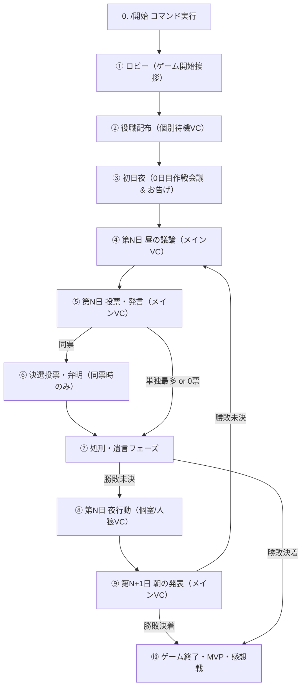

# 🐺 人狼 AI GM Bot - GM発話タイミング ＆ 進行時系列タイムライン

本書は、人狼ゲーム進行におけるフェーズ遷移と、**GM（およびスタッフBot）が音声（TTS）で発話するタイミング・セリフ・対象チャンネル・トリガー条件**を時系列順に網羅・整理したドキュメントです。
今後のレギュレーション読み上げ機能の実装や進行演出の改善に活用できます。

---

## 📌 1. 時系列タイムライン（全体フロー）

---

## 🎙️ 2. フェーズ別 GM発話タイミング詳細

### ① 開村・ゲーム開始フェーズ（ロビーVC）
- **場所**: ロビーVC（開始コマンドが実行されたVC）
- **参加者**: 全員集合中（ミュートなし）
- **処理**: 環境構築（カテゴリー・メインVC・人狼VC・霊界VC・個別待機部屋）完了後、GMがロビーVCへ一時接続。
- **🎙️ GM発話**:
  - **パターンA: レギュレーション読み上げ有効時（デフォルト: ON）**:
    - 定数: `MSG.VOICE.REGULATION_ANNOUNCE`
    - セリフ:
      > 「これより、人狼ゲームを開始します。本日のレギュレーションを発表します。
      > 参加人数は、{N}名。
      > 役職構成は、{村人○名、人狼○名、占い師○名…}です。
      > {初日のお告げあり/なし、連続護衛可能/なし}。
      > 第1日目の昼の議論時間は、{M}分間です。
      > 各自の待機部屋へこちらで移動させたのち、役職配布を開始いたします。それでは、いってらっしゃいませ！」
  - **パターンB: レギュレーション読み上げ無効時（オプション: OFF）**:
    - 定数: `MSG.VOICE.GREETING`
    - セリフ:
      > 「これより、人狼ゲームを開始します。各自の待機部屋へこちらで移動させたのち、役職配布を開始いたします。それでは、いってらっしゃいませ！」
- **直後の動作**: GMはロビーから退出。全プレイヤーを各自の個別待機VCへ強制移動し、全員をマイクミュート。

---

### ② 役職配布 ＆ 初日夜フェーズ（個別待機VC / 人狼VC）
- **場所**: 個別待機部屋（各プレイヤー専用VC）および 人狼VC
- **参加者**: 各自の個室に隔離（ミュート中）。人狼のみ人狼VCへ移動しミュート解除。
- **テキスト通知**: 各自の個別テキストチャンネルへ役職情報・役職説明を送信。
- **🎙️ GM / スタッフ発話**:
  1. **人狼作戦会議開始（人狼VC）**:
     - 定数: `MSG.VOICE.WOLF_MEET(settings.wolfMeetingMin)`
     - セリフ:
       > 「人狼の皆様、{N}分間の作戦会議です。スタート。」
  2. **占い師へのお告げ（占い師の個室VC）** ※「初日白通知（お告げ）」ルール有効時のみ:
     - 定数: `MSG.VOICE.SEER_FIRST(targetMember.displayName)`
     - セリフ:
       > 「初日のお告げです。{プレイヤー名}さんは、村人陣営です。」
  3. **キューピットへの促し＆決定アナウンス（キューピットの個室VC）**:
     - 促し定数: `MSG.VOICE.PROMPT_CUPID`
       > 「キューピットの方、運命の赤い糸で結ぶ2名を選択してください。」
     - 決定定数: `MSG.VOICE.CUPID_TARGET_SET(name1, name2)`
       > 「{プレイヤー1}さんと{プレイヤー2}さんを恋人として結びつけました。」
  4. **悪女への促し＆決定アナウンス（悪女の個室VC）**:
     - 促し定数: `MSG.VOICE.PROMPT_FEMME_FATALE`
       > 「悪女の方、本命1名と手玉を選択してください。」
     - 決定定数: `MSG.VOICE.FEMME_FATALE_TARGET_SET(name)`
       > 「{プレイヤー名}さんを本命として選びました。」
  5. **生霊への促し＆決定アナウンス（生霊の個室VC）**:
     - 促し定数: `MSG.VOICE.PROMPT_LIVING_SPIRIT`
       > 「生霊の方、憑依する対象を1名選択してください。」
     - 決定定数: `MSG.VOICE.LIVING_SPIRIT_TARGET_SET(name)`
       > 「{プレイヤー名}さんに憑依しました。」
  6. **人狼作戦会議終了（人狼VC）**:
     - 定数: `MSG.VOICE.WOLF_MEET_END`
     - セリフ:
       > 「内通時間終了です。夜が明けるまでしばらくお待ちください。」
- **直後の動作**: 人狼をミュート。第1日目昼の議論フェーズへ移行。

---

### ③ 昼の議論フェーズ（第N日 昼）
- **場所**: メインVC（および霊界VCへの同時中継・ブロードキャスト）
- **参加者**: 生存者全員がメインVCに集合（全員ミュート解除）。死亡者は霊界VCで聴取。
- **🎙️ GM発話**:
  1. **議論開始時**:
     - 定数: `MSG.VOICE.DAY_START(day, dayTimeMinutes)`
     - セリフ:
       > 「第{N}日目の議論時間は、{M}分間です。それでは、議論を開始してください。」
  2. **議論中（テキストのみ・音声なし）**:
     - 残り1分時にテキストチャンネルへ `⚠️ 残り1分です。` を送信。
     - （※デバッグモード時のみ、WorkerBotがランダムに短い相槌フレーズを発話）
  3. **議論時間終了時**:
     - 定数: `MSG.VOICE.DAY_END`
     - セリフ:
       > 「議論終了です。投票フェーズへ移行します。」
  4. **【特例】独裁者CO発動時（議論強制終了・即時処刑）**:
     - 独裁者が「独裁者CO」ボタンを押した瞬間に議論タイマーが強制停止、全員ミュート。
     - セリフ:
       > 「独裁者が名乗り出ました。これより独裁者による即時処刑が行われます。」
     - 独裁者が処刑者を1名指名し、通常の投票フェーズをスキップして即座に「⑥ 処刑フェーズ」へ移行。
- **直後の動作**: 生存者全員をマイクミュート。通常は投票フェーズへ移行。

---

### ④ 投票フェーズ（第N日 投票）
- **場所**: メインVC（および霊界VCへのブロードキャスト）
- **参加者**: 生存者全員（ミュート中）。発言ターンの1名のみ一時的にミュート解除。
- **🎙️ GM発話**:
  1. **発言順挙手待ちタイムアウト時（警告音声）** ※最大2回:
     - 定数: `MSG.VOICE.HAND_RAISE_WARNING`
     - セリフ:
       > 「この音声が終了するまでに挙手がなかった場合、ランダムに選出されます。」
  2. **各プレイヤーの発言ターン開始時**:
     - 対象プレイヤーのミュートを解除。
     - 定数: `MSG.VOICE.VOTE_START(name, timeStr)`
     - セリフ:
       > 「{プレイヤー名}さんの発言時間です。{制限時間}間です、どうぞ。」
  3. **投票未完了時の警告（発言終了後）** ※最大2回:
     - 定数: `MSG.VOICE.VOTE_TIMEOUT_WARNING`
     - セリフ:
       > 「この音声が終了するまでに投票がなかった場合、ランダムに選択されます。」
  4. **全員の投票完了（開票開始）時**:
     - 定数: `MSG.VOICE.VOTE_END`
     - セリフ:
       > 「全員の投票が完了しました。これより、開票を行います。」
- **分岐**:
  - 最多得票者が複数（同票） → **⑤ 決選投票フェーズへ**
  - 単独最多得票者あり → **⑥ 処刑フェーズへ**
  - 全員0票 → **⑥ 処刑フェーズ（処刑なし）へ**

---

### ⑤ 決選投票フェーズ（同票発生時）
- **場所**: メインVC（および霊界VCへのブロードキャスト）
- **参加者**: 生存者全員（ミュート中）。弁明対象者のみ順次ミュート解除。
- **🎙️ GM発話**:
  1. **決選投票開始時**:
     - 定数: `MSG.VOICE.RUNOFF_START`
     - セリフ:
       > 「最多得票者が複数いらっしゃるため、これより決選投票を行います。対象者をランダムで選定し、1分間ずつ弁明をしていただきます。」
  2. **弁明挙手なし警告** ※挙手タイムアウト時:
     - 定数: `MSG.VOICE.HAND_RAISE_WARNING`（上記と同様）
  3. **弁明ターン開始時**:
     - 対象プレイヤーのミュート解除。
     - 定数: `MSG.VOICE.RUNOFF_DEFENSE_START(name, timeStr)`
     - セリフ:
       > 「{プレイヤー名}さんの弁明時間です。時間は{制限時間}です、どうぞ。」
  4. **弁明終了時**:
     - 定数: `MSG.VOICE.RUNOFF_DEFENSE_END`
     - セリフ:
       > 「終了です。」
  5. **決選投票受付開始時**:
     - 定数: `MSG.VOICE.RUNOFF_VOTE_PROMPT(voteTimeStr)`
     - セリフ:
       > 「それでは、対象者以外の方は、{制限時間}以内に投票を行ってください。時間を過ぎますと、システムが対象者の中からランダムで強制投票を行います。」
- **直後の動作**: 開票集計を行い、処刑フェーズへ移行。

---

### ⑥ 処刑・遺言フェーズ（第N日 処刑）
- **場所**: メインVC（および霊界VCへのブロードキャスト）
- **参加者**: 生存者全員（ミュート中）。処刑される1名のみ遺言のためミュート解除。
- **🎙️ GM発話**:
  - **パターンA: 処刑なし（全員0票）の場合**:
    1. 定数: `MSG.VOICE.EXEC_NONE`
       > 「投票の結果、全員0票だったため、本日の処刑はありませんでした。」
    2. 定数: `MSG.VOICE.NIGHT_INTRO_NONE`
       > 「処刑は行われず、夜が・・・」
  - **パターンB: 処刑ありの場合**:
    1. 処刑執行・遺言案内:
       - 対象者のミュート解除。
       - 通常処刑時: 定数 `MSG.VOICE.EXEC_START(executedName)`
         > 「{プレイヤー名}さんが処刑されます。遺言をどうぞ。」
       - 独裁者処刑時: 定数 `MSG.VOICE.DICTATOR_EXEC(executedName)`
         > 「独裁者の命により、{プレイヤー名}さんが処刑されます。遺言をどうぞ。」
    2. （棺桶屋の的中アナウンスがある場合のみ）:
       - 棺桶屋の噂メッセージをGMが音声読み上げ。
    3. （特殊道連れ・能力誘発時のGM音声アナウンス）:
       - **ハンター処刑時**:
         - 定数: `MSG.VOICE.HUNTER_SHOOT(victimName)`
         - セリフ: > 「銃声が響き渡りました。ハンターの道連れにより、{プレイヤー名}さんが息絶えました。」
       - **黒猫処刑時**:
         - 定数: `MSG.VOICE.BLACK_CAT_REVENGE(victimName)`
         - セリフ: > 「黒猫の呪いにより、{プレイヤー名}さんが道連れになりました。」
       - **人狼の子ども処刑時**:
         - 定数: `MSG.VOICE.WOLF_CUB_ENRAGED`
         - セリフ: > 「人狼の子どもの死により、狼たちが激怒しています。今夜の襲撃は2回となります。」
       - **恋人の後追い死発生時**:
         - 定数: `MSG.VOICE.LOVERS_FOLLOW(loverName)`
         - セリフ: > 「愛する者の死に絶望し、恋人の{プレイヤー名}さんが後を追って息絶えました。」
       - **女王処刑・死亡時（ショック死）**:
         - 定数: `MSG.VOICE.QUEEN_DIED`
         - セリフ: > 「女王が崩御されました。市民陣営は深い悲しみにより全滅しました。」
       - **女王死亡・生霊即位時**:
         - 定数: `MSG.VOICE.QUEEN_INHERITED(newQueenName)`
         - セリフ: > 「生霊が女王の遺志を継ぎ、新たな女王となりました。市民の全滅は免れました。」
    4. 夜への導入:
       - 遺言時間終了後、対象者を再ミュート。
       - 定数: `MSG.VOICE.NIGHT_INTRO(executedName)`
       - セリフ:
         > 「{プレイヤー名}さんが処刑され、夜が・・・」
- **分岐**:
  - 処刑（または女王崩御・てるてる坊主処刑・棺桶屋2回的中）により勝敗が決着した場合 → **⑨ 終了フェーズへ**
  - 勝敗未決の場合 → **⑦ 夜フェーズへ**（※「夜が・・・やってきます。」と繋がる）

---

### ⑦ 夜フェーズ（第N日 夜行動）
- **場所**: 個別待機部屋（各個室VC）および 人狼VC
- **参加者**: 処刑の「夜が・・・」に続き、全員が個別待機部屋へ移動。
- **🎙️ GM / スタッフ発話**:
  1. **夜の訪れ（メインVC / 霊界VC）**:
     - 定数: `MSG.VOICE.NIGHT_ARRIVE` （※中断再開時は `MSG.VOICE.NIGHT_ARRIVE_RESUMED`）
     - セリフ:
       > 「やってきます。個別部屋へ移動します。」
       > （再開時: 「中断再開のため1分延長します。」）
  2. **個別役職への音声案内（各部屋へスタッフBotが接続して個別発話）**:
     - **霊媒師 (個室VC / Worker 0)**:
       - 定数: `MSG.VOICE.MEDIUM_RESULT(name, isWolf)`
       - セリフ:
         > 「霊媒結果をお伝えします。処刑された{プレイヤー名}さんは、{人狼でした / 人狼ではありませんでした}。」
     - **人狼 (人狼VC / Worker 1)**:
       - 通常時 襲撃先選択の促し:
         - 定数: `MSG.VOICE.PROMPT_WOLF`
         - セリフ: > 「内通時間終了です。人狼の皆様、今夜襲撃する対象を選択してください。」
       - 2回襲撃時（子狼処刑後/凶暴な狼）選択の促し:
         - 定数: `MSG.VOICE.PROMPT_WOLF_DOUBLE`
         - セリフ: > 「今夜は2回襲撃が可能です。襲撃する対象を2名選択してください。」
       - 通常時 襲撃先決定時:
         - 定数: `MSG.VOICE.WOLF_TARGET_SET(targetName)`
         - セリフ: > 「襲撃先は、${name}さんですね。」
       - 2回襲撃決定時:
         - 定数: `MSG.VOICE.WOLF_TARGET_SET_DOUBLE(name1, name2)`
         - セリフ: > 「襲撃先は、${name1}さんと、${name2}さんですね。」
     - **占い師 (個室VC / Worker 2)**:
       - 占い対象選択の促し:
         - 定数: `MSG.VOICE.PROMPT_SEER`
         - セリフ: > 「占い師の方、今夜占う対象を選択してください。」
       - 占い結果判明時:
         - 定数: `MSG.VOICE.SEER_RESULT(isWolf)`
         - セリフ: > 「結果は、{人狼でした / 人狼ではありませんでした}。」
     - **騎士 (個室VC / Worker 3)**:
       - 護衛対象選択の促し:
         - 定数: `MSG.VOICE.PROMPT_KNIGHT`
         - セリフ: > 「騎士の方、今夜護衛する対象を選択してください。」
       - 護衛先決定時:
         - 定数: `MSG.VOICE.KNIGHT_TARGET_SET(targetName)`
         - セリフ: > 「{プレイヤー名}さんを護衛します。」
     - **未熟な占い師 (個室VC / Worker 4)** ※能力有効時のみ:
       - 占い＋予想の促し:
         - 定数: `MSG.VOICE.PROMPT_APPRENTICE_SEER`
         - セリフ: > 「未熟な占い師の方、今夜占う対象と予想を選択してください。」
       - 占い結果・予想判定時:
         - 定数: `MSG.VOICE.APPRENTICE_SEER_RESULT(isWolf, isCorrect)`
         - セリフ: > 「結果は、{人狼でした / 人狼ではありませんでした}。予想は、{的中しました / 外れてしまいました}。」
     - **無謀な占い師 (個室VC / Worker 5)**:
       - 占い対象選択の促し:
         - 定数: `MSG.VOICE.PROMPT_RECKLESS_SEER`
         - セリフ: > 「無謀な占い師の方、今夜占う対象を選択してください。」
       - 占い結果判明時:
         - 定数: `MSG.VOICE.SEER_RESULT(isWolf)`
         - セリフ: > 「結果は、{人狼でした / 人狼ではありませんでした}。」
     - **狐憑き (個室VC / Worker 6)**:
       - 加護対象選択の促し:
         - 定数: `MSG.VOICE.PROMPT_FOX_POSSESSED`
         - セリフ: > 「狐憑きの方、今夜加護を与える対象を選択してください。」
       - 加護先決定時:
         - 定数: `MSG.VOICE.FOX_PROTECT_SET(targetName)`
         - セリフ: > 「{プレイヤー名}さんに狐の加護を与えます。」
     - **棺桶屋 (個室VC / Worker 7)**:
       - 処刑予想選択の促し:
         - 定数: `MSG.VOICE.PROMPT_UNDERTAKER`
         - セリフ: > 「棺桶屋の方、明日処刑される人物を予想してください。」
       - 処刑予想決定時:
         - 定数: `MSG.VOICE.UNDERTAKER_TARGET_SET(targetName)`
         - セリフ: > 「明日処刑される人物を、{プレイヤー名}さんと予想しました。」
     - **罠師 (個室VC / Worker 8)**:
       - 罠設置選択の促し:
         - 定数: `MSG.VOICE.PROMPT_TRAPPER`
         - セリフ: > 「罠師の方、今夜罠を仕掛ける対象を選択してください。」
       - 罠設置完了時:
         - 定数: `MSG.VOICE.TRAPPER_TARGET_SET(targetName)`
         - セリフ: > 「{プレイヤー名}さんに罠を仕掛けました。」
     - **カウンセラー (個室VC / Worker 9)**:
       - 更生選択の促し:
         - 定数: `MSG.VOICE.PROMPT_COUNSELOR`
         - セリフ: > 「カウンセラーの方、今夜更生を試みる対象を選択してください。」
       - 更生対象決定時:
         - 定数: `MSG.VOICE.COUNSELOR_TARGET_SET(targetName)`
         - セリフ: > 「{プレイヤー名}さんにカウンセリングを行います。」
     - **スパイ (個室VC / Worker 10)**:
       - 妨害選択の促し:
         - 定数: `MSG.VOICE.PROMPT_SPY`
         - セリフ: > 「スパイの方、今夜能力を妨害する対象を選択してください。」
       - 妨害対象決定時:
         - 定数: `MSG.VOICE.SPY_TARGET_SET(targetName)`
         - セリフ: > 「{プレイヤー名}さんの能力を妨害します。」
     - **ハンター (個室VC / Worker 11)**:
       - 事前道連れ選択の促し:
         - 定数: `MSG.VOICE.PROMPT_HUNTER`
         - セリフ: > 「ハンターの方、万一の際に道連れにする対象を事前選択してください。」
       - 道連れ先決定時:
         - 定数: `MSG.VOICE.HUNTER_TARGET_SET(targetName)`
         - セリフ: > 「万一の道連れ先として、{プレイヤー名}さんを指定しました。」
     - **占い師の弟子 (覚醒後) (個室VC / Worker 12)**:
       - 占い対象選択の促し:
         - 定数: `MSG.VOICE.PROMPT_APPRENTICE_DIVINER_AWAKENED`
         - セリフ: > 「師匠の占い師が死亡したため、占いの力が覚醒しました。今夜占う対象を選択してください。」
       - 占い結果判明時:
         - 定数: `MSG.VOICE.SEER_RESULT(isWolf)`
         - セリフ: > 「結果は、{人狼でした / 人狼ではありませんでした}。」
- **直後の動作**: 全員の夜アクション完了 ＆ トイレ離席者が全員帰還後、勝敗判定。

---

### ⑧ 朝の発表フェーズ（第N+1日 朝）
- **場所**: メインVC（昨晩の犠牲者も含めてメインVCに一時集合）
- **参加者**: 生存者全員 ＋ 昨晩の死亡者。過去の死亡者は霊界VC。
- **🎙️ GM発話**:
  1. **犠牲者ありの場合**:
     - セリフ:
       > 「おはようございます。昨晩の犠牲者は・・・{プレイヤー名}さんでした。（＋パン屋情報）」
  2. **犠牲者なし（平和な朝）の場合**:
     - 定数: `MSG.VOICE.MORNING_PEACE`
     - セリフ:
       > 「おはようございます。昨晩の犠牲者は・・・いませんでした。（＋パン屋情報）」
  3. （※パン屋の生存・死亡アナウンスがある場合は末尾に結合）:
     - 生存時: `「また、今朝もパン屋がおいしいパンを焼いてくれました。」`
     - 死亡時: `「しかし、今朝はパン屋からパンが届きませんでした。」`
- **直後の動作**: 昨晩の犠牲者を霊界VCへ移動し、ミュート解除。勝敗判定へ。
  - 勝敗決着時 → **⑨ 終了フェーズへ**
  - 勝敗未決時 → **③ 昼の議論フェーズ（第N+1日）へ**

---

### ⑨ 終了フェーズ（勝利宣言・MVP・感想戦）
- **場所**: メインVC（全員集合、全員ミュート解除）
- **🎙️ GM発話**:
  1. **勝利宣言音声**:
     - **処刑による村人勝利**:
       - 定数: `MSG.VOICE.WIN_EXECUTION_VILLAGER`
       - セリフ:
         > 「やってきません。人狼陣営がいなくなったため、村人陣営の勝利です。」
     - **処刑による人狼勝利**:
       - 定数: `MSG.VOICE.WIN_EXECUTION_WOLF`
       - セリフ:
         > 「やってきません。人狼陣営と村人陣営の数が同数となったため、人狼陣営の勝利です。」
     - **襲撃による人狼勝利**:
       - 定数: `MSG.VOICE.WIN_BITE_WOLF`
       - セリフ:
         > 「昼議論はありません。現在、人狼陣営と村人陣営の数が同数となったため、人狼陣営の勝利です！」
  2. **AI総評（Gemini MVP）開始前アナウンス** ※録音・講評ON時のみ:
     - 定数: `MSG.VOICE.MVP_NEXT`
     - セリフ:
       > 「それではこれより、Gemini AIによるMVP選出を行います。少々お待ちください。」
  3. **MVP発表音声**:
     - **単独MVPモード**:
       - 定数: `MSG.VOICE.MVP_ANNOUNCE_SINGLE(title, name)`
       - セリフ:
         > 「本日の{タイトル}は、{プレイヤー名}さんです！お疲れ様でした。」
     - **ダブルMVPモード（compare）**:
       - 定数: `MSG.VOICE.MVP_ANNOUNCE_DOUBLE(name1, name2)`
       - セリフ:
         > 「本日の議論MVPは{プレイヤー1}さん、勝利貢献MVPは{プレイヤー2}さんです！お疲れ様でした。」
- **直後の動作**: 感想戦。一定時間経過後、チャンネル・ロールの後片付けを行いロビーVCへ復帰。

---

## 📋 3. GM発話一覧サマリー表

| # | フェーズ | 発話タイミング | 音声定数名 | 放送先VC | 聞いている対象 |
|---|---|---|---|---|---|
| 1 | 開村 | `/開始` 後、環境構築完了直後（レギュレーション読み上げ） | `REGULATION_ANNOUNCE` / `GREETING` | ロビーVC | 全員（移動前） |
| 2 | 初日夜 | 人狼内通開始時 | `WOLF_MEET` | 人狼VC | 人狼のみ |
| 3 | 初日夜 | 初日白通知（お告げ: 通常/未熟/無謀占い師） | `SEER_FIRST` | 占い師個室VC | 占い師のみ |
| 4 | 初日夜 | キューピット: 恋人2名指名の促し | `PROMPT_CUPID` | キューピット個室VC | キューピットのみ |
| 5 | 初日夜 | キューピット: 恋人指定完了アナウンス | `CUPID_TARGET_SET` | キューピット個室VC | キューピットのみ |
| 6 | 初日夜 | 悪女: 本命指定の促し | `PROMPT_FEMME_FATALE` | 悪女個室VC | 悪女のみ |
| 7 | 初日夜 | 悪女: 本命指定完了アナウンス | `FEMME_FATALE_TARGET_SET` | 悪女個室VC | 悪女のみ |
| 8 | 初日夜 | 生霊: 憑依先指定の促し | `PROMPT_LIVING_SPIRIT` | 生霊個室VC | 生霊のみ |
| 9 | 初日夜 | 生霊: 憑依指定完了アナウンス | `LIVING_SPIRIT_TARGET_SET` | 生霊個室VC | 生霊のみ |
| 10 | 初日夜 | 人狼内通終了時 | `WOLF_MEET_END` | 人狼VC | 人狼のみ |
| 11 | 昼議論 | 議論開始時 | `DAY_START` | メインVC & 霊界VC | 生存者 & 死亡者 |
| 12 | 昼議論 | 議論時間終了時 | `DAY_END` | メインVC & 霊界VC | 生存者 & 死亡者 |
| 13 | 昼議論 | 【特例】独裁者CO発動アナウンス | `DICTATOR_CO` | メインVC & 霊界VC | 生存者 & 死亡者 |
| 14 | 投票 | 挙手なし警告（タイムアウト時） | `HAND_RAISE_WARNING` | メインVC & 霊界VC | 生存者 & 死亡者 |
| 15 | 投票 | 各人の発言開始時 | `VOTE_START` | メインVC & 霊界VC | 生存者 & 死亡者 |
| 16 | 投票 | 投票なし警告（タイムアウト時） | `VOTE_TIMEOUT_WARNING` | メインVC & 霊界VC | 生存者 & 死亡者 |
| 17 | 投票 | 全員投票完了（開票時） | `VOTE_END` | メインVC & 霊界VC | 生存者 & 死亡者 |
| 18 | 決選投票 | 決選投票開始時 | `RUNOFF_START` | メインVC & 霊界VC | 生存者 & 死亡者 |
| 19 | 決選投票 | 各対象者の弁明開始時 | `RUNOFF_DEFENSE_START` | メインVC & 霊界VC | 生存者 & 死亡者 |
| 20 | 決選投票 | 弁明終了時 | `RUNOFF_DEFENSE_END` | メインVC & 霊界VC | 生存者 & 死亡者 |
| 21 | 決選投票 | 決選投票受付開始時 | `RUNOFF_VOTE_PROMPT` | メインVC & 霊界VC | 生存者 & 死亡者 |
| 22 | 処刑 | 処刑なし時（0票） | `EXEC_NONE` | メインVC & 霊界VC | 生存者 & 死亡者 |
| 23 | 処刑 | 通常処刑執行・遺言開始時 | `EXEC_START` | メインVC & 霊界VC | 生存者 & 死亡者 |
| 24 | 処刑 | 独裁者処刑執行・遺言開始時 | `DICTATOR_EXEC` | メインVC & 霊界VC | 生存者 & 死亡者 |
| 25 | 処刑 | 棺桶屋処刑予想的中アナウンス（1回目） | 特殊アナウンス | メインVC & 霊界VC | 生存者全員 |
| 26 | 処刑 | 人狼の子ども処刑時（親狼激怒） | `WOLF_CUB_ENRAGED` | メインVC & 霊界VC | 生存者全員 |
| 27 | 処刑 | 黒猫処刑時（人狼以外へ呪い道連れ） | `BLACK_CAT_REVENGE` | メインVC & 霊界VC | 生存者全員 |
| 28 | 処刑 | ハンター処刑時（道連れ銃殺） | `HUNTER_SHOOT` | メインVC & 霊界VC | 生存者全員 |
| 29 | 処刑 | 恋人後追い死発生時 | `LOVERS_FOLLOW` | メインVC & 霊界VC | 生存者全員 |
| 30 | 処刑 | 女王崩御時（市民全員ショック死） | `QUEEN_DIED` | メインVC & 霊界VC | 全員 |
| 31 | 処刑 | 女王死亡時（生霊が新女王に即位） | `QUEEN_INHERITED` | メインVC & 霊界VC | 生存者全員 |
| 32 | 処刑 | 夜への導入（処刑なし時） | `NIGHT_INTRO_NONE` | メインVC | 生存者全員 |
| 33 | 処刑 | 夜への導入（処刑あり時） | `NIGHT_INTRO` | メインVC | 生存者全員 |
| 34 | 夜 | 夜の訪れ（個室移動直前） | `NIGHT_ARRIVE` | メインVC & 霊界VC | 全員 |
| 35 | 夜 | 霊媒結果伝達 | `MEDIUM_RESULT` | 霊媒師個室VC | 霊媒師のみ |
| 36 | 夜 | 通常時 襲撃先選択の促し | `PROMPT_WOLF` | 人狼VC | 人狼のみ |
| 37 | 夜 | 2回襲撃時 襲撃先選択の促し | `PROMPT_WOLF_DOUBLE` | 人狼VC | 人狼のみ |
| 38 | 夜 | 通常時 襲撃先決定アナウンス | `WOLF_TARGET_SET` | 人狼VC | 人狼のみ |
| 39 | 夜 | 2回襲撃時 襲撃先決定アナウンス | `WOLF_TARGET_SET_DOUBLE` | 人狼VC | 人狼のみ |
| 40 | 夜 | 占い対象選択の促し（通常占い師） | `PROMPT_SEER` | 占い師個室VC | 占い師のみ |
| 41 | 夜 | 占い結果伝達（通常占い師） | `SEER_RESULT` | 占い師個室VC | 占い師のみ |
| 42 | 夜 | 護衛対象選択の促し（騎士） | `PROMPT_KNIGHT` | 騎士個室VC | 騎士のみ |
| 43 | 夜 | 護衛先決定アナウンス（騎士） | `KNIGHT_TARGET_SET` | 騎士個室VC | 騎士のみ |
| 44 | 夜 | 未熟な占い師: 占い＋予想の促し | `PROMPT_APPRENTICE_SEER` | 未熟占い師個室VC | 未熟な占い師のみ |
| 45 | 夜 | 未熟な占い師: 結果＋予想判定伝達 | `APPRENTICE_SEER_RESULT` | 未熟占い師個室VC | 未熟な占い師のみ |
| 46 | 夜 | 無謀な占い師: 占い対象選択の促し | `PROMPT_RECKLESS_SEER` | 無謀占い師個室VC | 無謀な占い師のみ |
| 47 | 夜 | 無謀な占い師: 占い結果伝達 | `SEER_RESULT` | 無謀占い師個室VC | 無謀な占い師のみ |
| 48 | 夜 | 狐憑き: 加護対象選択の促し | `PROMPT_FOX_POSSESSED` | 狐憑き個室VC | 狐憑きのみ |
| 49 | 夜 | 狐憑き: 加護先決定アナウンス | `FOX_PROTECT_SET` | 狐憑き個室VC | 狐憑きのみ |
| 50 | 夜 | 棺桶屋: 処刑予想選択の促し | `PROMPT_UNDERTAKER` | 棺桶屋個室VC | 棺桶屋のみ |
| 51 | 夜 | 棺桶屋: 処刑予想決定アナウンス | `UNDERTAKER_TARGET_SET` | 棺桶屋個室VC | 棺桶屋のみ |
| 52 | 夜 | 罠師: 罠設置選択の促し | `PROMPT_TRAPPER` | 罠師個室VC | 罠師のみ |
| 53 | 夜 | 罠師: 罠設置決定アナウンス | `TRAPPER_TARGET_SET` | 罠師個室VC | 罠師のみ |
| 54 | 夜 | カウンセラー: 更生選択の促し | `PROMPT_COUNSELOR` | カウンセラー個室VC | カウンセラーのみ |
| 55 | 夜 | カウンセラー: 更生決定アナウンス | `COUNSELOR_TARGET_SET` | カウンセラー個室VC | カウンセラーのみ |
| 56 | 夜 | スパイ: 妨害選択の促し | `PROMPT_SPY` | スパイ個室VC | スパイのみ |
| 57 | 夜 | スパイ: 妨害決定アナウンス | `SPY_TARGET_SET` | スパイ個室VC | スパイのみ |
| 58 | 夜 | ハンター: 夜道連れ事前指定の促し | `PROMPT_HUNTER` | ハンター個室VC | ハンターのみ |
| 59 | 夜 | ハンター: 道連れ指定決定アナウンス | `HUNTER_TARGET_SET` | ハンター個室VC | ハンターのみ |
| 60 | 夜 | 占い師の弟子: 覚醒後占い選択の促し | `PROMPT_APPRENTICE_DIVINER_AWAKENED` | 弟子個室VC | 弟子のみ |
| 61 | 夜 | 占い師の弟子: 占い結果伝達 | `SEER_RESULT` | 弟子個室VC | 弟子のみ |
| 62 | 朝 | 昨晩の犠牲者発表（＋パン屋アナウンス） | `MORNING_ANNOUNCE` | メインVC | 生存者 ＋ 昨晩の死亡者 |
| 63 | 終局 | 処刑による勝利宣言（村人/人狼） | `WIN_EXECUTION_*` | メインVC & 霊界VC | 全員 |
| 64 | 終局 | 襲撃による勝利宣言（人狼） | `WIN_BITE_WOLF` | メインVC & 霊界VC | 全員 |
| 65 | 終局 | 恋人陣営勝利宣言 | `WIN_LOVERS` | メインVC & 霊界VC | 全員 |
| 66 | 終局 | 一匹狼単独勝利宣言 | `WIN_LONE_WOLF` | メインVC & 霊界VC | 全員 |
| 67 | 終局 | 神様単独勝利宣言 | `WIN_GOD` | メインVC & 霊界VC | 全員 |
| 68 | 終局 | てるてる坊主単独勝利宣言 | `WIN_FOOL` | メインVC & 霊界VC | 全員 |
| 69 | 終局 | 棺桶屋単独勝利宣言 | `WIN_UNDERTAKER` | メインVC & 霊界VC | 全員 |
| 70 | 終局 | 妖狐陣営勝利宣言 | `WIN_FOX` | メインVC & 霊界VC | 全員 |
| 71 | 終局 | AI総評開始予告 | `MVP_NEXT` | メインVC & 霊界VC | 全員 |
| 72 | 終局 | MVP表彰発表 | `MVP_ANNOUNCE_*` | メインVC & 霊界VC | 全員 |

---

## 💡 4. 「レギュレーション読み上げ」の実装仕様（実装済み）

ユーザー要望に基づき、【候補案A】を採用し、ゲーム開始時にGMがロビーVCでレギュレーションを自動読み上げする機能を実装しました。

### 仕様概要
- **デフォルト動作**: **有効（ON）**
- **切り替え設定（OFF/ON）**:
  1. **レギュレーション個別設定**: レギュレーションビルダー内の「📜 レギュレーション読み上げの有効化」トグルスイッチ。
  2. **全体システム設定**: ゲーム設定画面内の「📜 レギュレーション読み上げの有効化（全体デフォルト）」。
  3. **Discordコマンドオプション**: `/開始` 実行時のオプション `レギュレーション読み上げ: True/False`（指定時はコマンドが最優先）。
- **読み上げ内容**:
  1. 参加人数（`参加人数は、{N}名。`）
  2. 役職構成（`役職構成は、村人○名、人狼○名、占い師○名…です。`）※人狼で標準的な役職順にソートして読み上げ
  3. ルール設定（`初日のお告げあり/なし`、`連続護衛可能/なし` など）
  4. 昼の議論時間（`第1日目の昼の議論時間は、{M}分間です。`）
  5. 待機部屋移動の合図（`各自の待機部屋へこちらで移動させたのち、役職配布を開始いたします。それでは、いってらっしゃいませ！`）
- **OFF時のフォールバック**:
  - OFFの場合は従来の短い開始挨拶（`MSG.VOICE.GREETING`）のみを再生し、素早く個室移動へ進みます。
